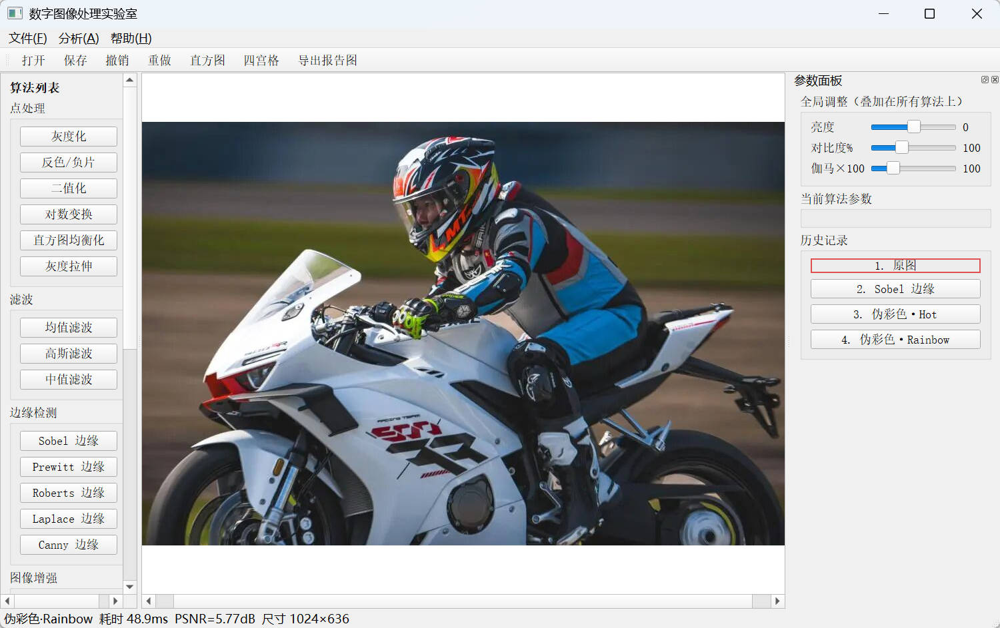
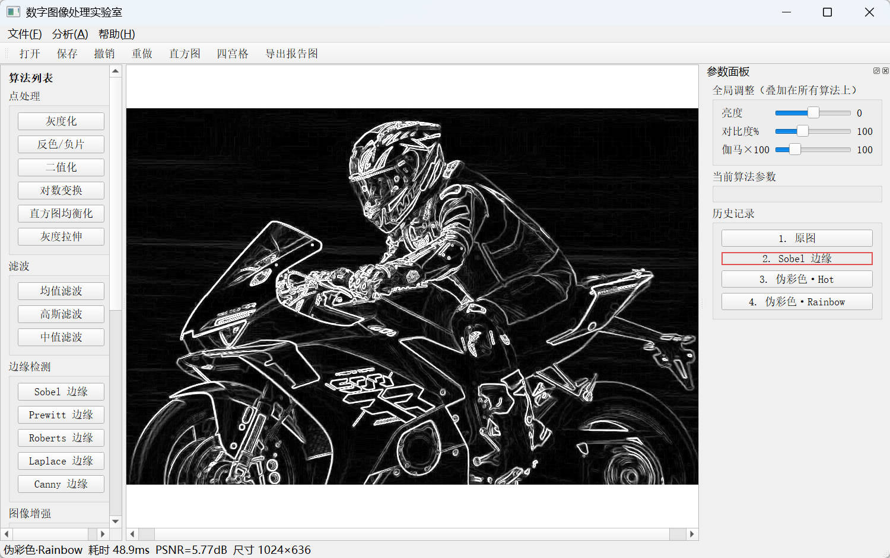

# 数字图像处理实验室 / Digital Image Processing Lab

[](LICENSE)
[](https://www.python.org/)
[]()

一个基于 **PyQt5 + NumPy + OpenCV** 的桌面端数字图像处理教学与演示工具，同时提供**纯网页版**（双击即用，无需安装）。
定位是「算法实验室」而非「迷你 Photoshop」——所有经典 DSP 算法一键调用、参数实时可调、支持算法对比和报告图导出，适合课程作业、算法学习和论文实验。





## 两种使用方式

### 🖥️ 桌面版（功能完整）
```bash
pip install -r requirements.txt
python main.py
```

### 🌐 网页版（免安装，打开即用）
直接用浏览器打开 [`web/index.html`](web/index.html)，所有处理在本地完成，不上传任何图片。
包含：灰度化、反色、二值化、亮度/对比度实时调整、高斯模糊、Sobel 边缘、保存图片。

## 功能一览

### 点处理
- 灰度化（BT.601 加权）
- 反色 / 负片
- 二值化（阈值可调，支持直方图拖拽阈值线）
- 对数变换
- 直方图均衡化
- 灰度拉伸（低/高切点可调）

### 空间滤波
- 均值滤波（核大小可调）
- 高斯滤波（核大小 / σ 可调）
- 中值滤波（核大小可调）

### 边缘检测
- Sobel / Prewitt / Roberts
- Laplace 边缘
- Canny 边缘（双阈值可调）

### 图像增强
- Laplace 锐化

### 形态学
- 腐蚀 / 膨胀 / 开运算 / 闭运算（核大小、迭代次数可调）

### 伪彩色
- Jet / Hot / Cool / Rainbow

### 几何变换
- 水平 / 垂直翻转
- 旋转 90° / 180°

### 分析与导出
- 灰度直方图分析（可拖拽阈值线）
- 四宫格算法对比（原图 / 灰度 / Sobel / 当前结果）
- 一键导出报告图（原图 + 结果 + 直方图）
- PSNR 量化指标实时显示
- 算法耗时 ms 实时显示

## 快速开始

### 环境要求
- Python 3.8 及以上
- Windows / macOS / Linux

### 安装
```bash
git clone https://github.com/你的用户名/image-processor.git
cd image-processor
pip install -r requirements.txt
```

### 运行
```bash
python main.py
```

Windows 用户也可以直接双击 `启动.bat`。

## 快捷键

| 快捷键 | 功能 |
|---|---|
| `Ctrl+O` | 打开图片 |
| `Ctrl+S` | 保存结果 |
| `Ctrl+E` | 导出报告图 |
| `Ctrl+Z` / `Ctrl+Y` | 撤销 / 重做 |
| `空格`（按住） | 临时查看原图 |
| 鼠标滚轮 | 画布缩放 |
| 鼠标拖拽 | 画布平移 |
| 鼠标移动 | 状态栏显示像素 RGB 值 |

## 项目结构

```
image-processor/
├── main.py           # PyQt5 主窗口与交互
├── algorithms.py     # 全部图像处理算法（NumPy / OpenCV 实现）
├── requirements.txt  # 依赖清单
├── LICENSE           # MIT 开源协议
├── 启动.bat          # Windows 一键启动
└── samples/          # 示例图片
```

## 技术说明

- **交互路径走 OpenCV 快路径**：滤波、边缘检测、形态学等算法调用 OpenCV 优化实现，大图流畅无卡顿。
- **算法原理保留教学版**：`algorithms.py` 中保留了 `mean_filter_slow` 等纯 NumPy 手写实现，便于对照教科书原理。
- **PSNR 实时计算**：每次处理自动计算与原图的 PSNR（Peak Signal-to-Noise Ratio），用于量化算法保真度。

## 路线图

- [ ] FFT 频域低通 / 高通滤波
- [ ] 任意角度旋转与缩放
- [ ] ROI 区域裁剪
- [ ] 直方图匹配（规定化）
- [ ] 噪声添加（高斯 / 椒盐）
- [ ] 批量处理

## 贡献

欢迎提交 Issue 和 Pull Request。

## 许可证

[MIT](LICENSE)
